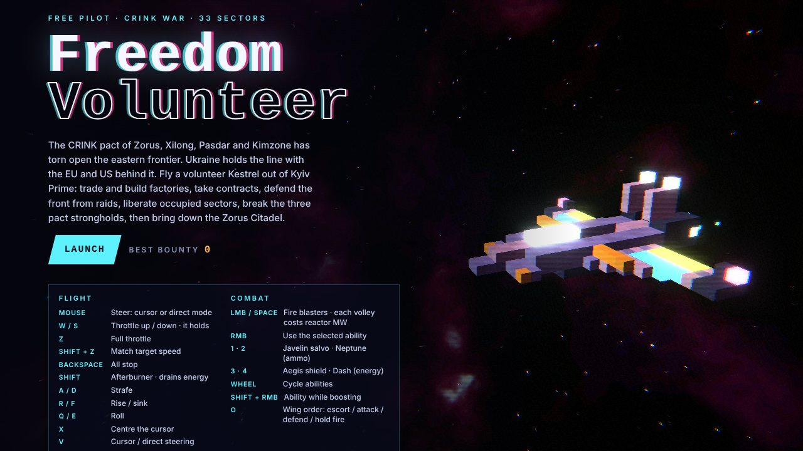
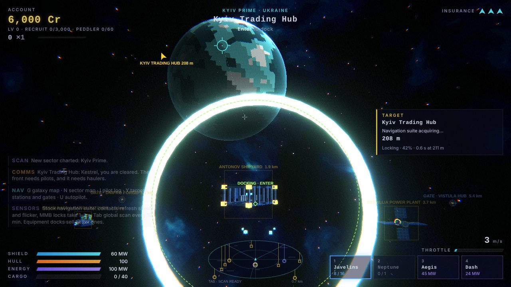
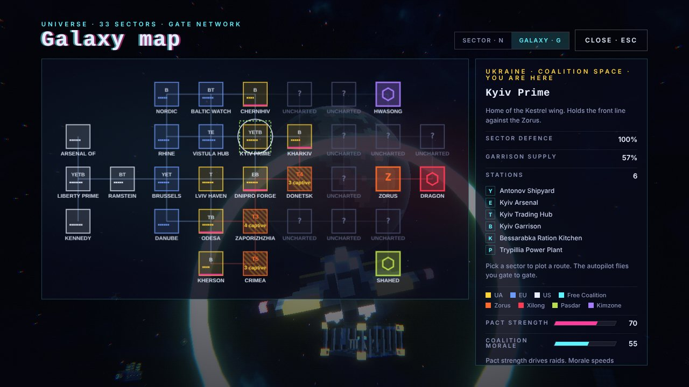
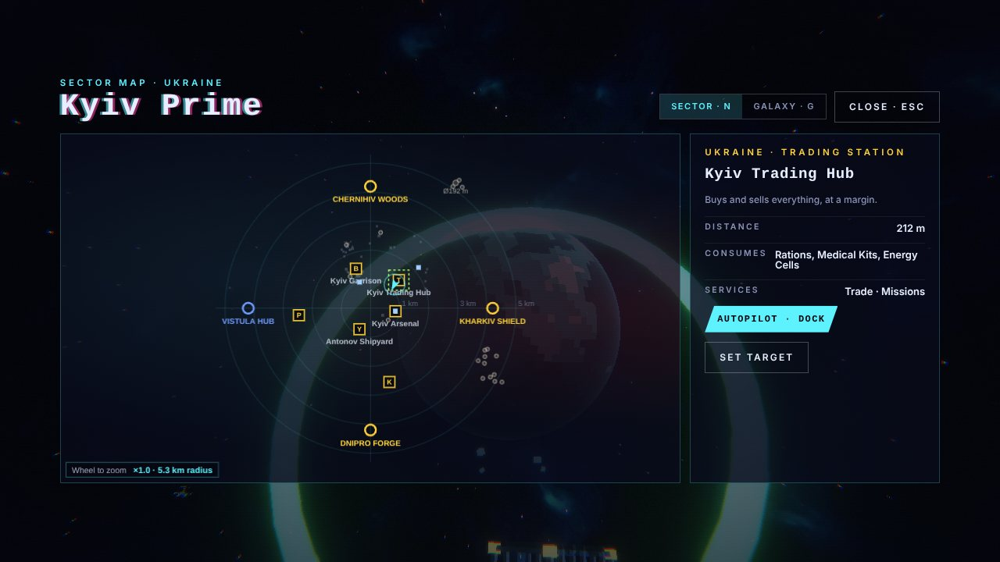

# Freedom Volunteer

A volunteer pilot, a battered Kestrel fighter and a frontier at war. Fly out of
Kyiv Prime for the Coalition — Ukraine, with the EU and the US behind it — against
the fictional CRINK pact. Trade and build factories, take contracts, defend the
front from raids, liberate occupied sectors, break the three pact strongholds,
then bring down the Zorus Citadel.

A 3D space sim in voxel-neon style that plays in the browser, no install.

**Devlog page:** https://yur4ak.github.io/freedom-volunteer-devlog/

## What's in it

- **33 hand-placed sectors** joined by jump gates, with a live production economy:
  11 wares, stations that consume and produce, freighters that move goods, prices that follow stock
- **A war front that moves on its own** — raids, occupation, liberation, counter-offensives,
  and pact strength / coalition morale meters
- **Imperfect instruments you upgrade** — the stock navigation suite lags, flickers and loses lock;
  better suites, reactors and software sharpen the picture
- **Enemies with personalities** — kamikaze drones that dodge fire, fighters that make gun runs,
  snipers, minelayers, shielded gunships, drone carriers, EW jammers, flagships, and a rank
  ladder that grows with yours
- **Solid voxel asteroids** you carve one cube at a time, with hidden veins to scan and map
- **Wingmen, hired trader pilots, missions, your own factories**, a pilot log and a campaign save
- **Black holes** lead to two bonus levels: an event-horizon tunnel and a wrapping tesseract
- **Procedural everything** — every ship, station and rock is voxel-generated in code, and all
  sound and music are synthesized live

| | |
|---|---|
|  |  |
| *Undocking at Kyiv Prime* | *The 33-sector galaxy map* |

## Status

**Prototype complete (v9.1) · preparing the public release.**
Free to play on itch.io is the plan, with an optional donation: **$2–$5 unlocks small cosmetic
supporter perks**. Nothing that affects combat or the economy is for sale.

## Where donations go

**30% of every donation, of any amount, goes to the Armed Forces of Ukraine (ZSU).**
The rest supports development of the game.

## Try it

Coming soon on itch.io. Desktop browser, mouse and keyboard.

## Built with

JavaScript · Three.js · WebGL · procedural voxels · synthesized audio · no engine

---

# Updates

## 14 Oct 2026 — v9.1: the name is official
- **Freedom Volunteer** is now the name everywhere: title screen, interface and the Codex
- Supply runs can be split across several trips; the mission board shows a delivery progress bar
  and the HUD counts down what is still due. Miss the deadline and you are still paid half rate
  for what you delivered
- No more duplicate supply runs for the same goods at the same station
- The sector map shows its zoom level and the radius in view
- Donation terms settled: **$2–$5 unlocks the supporter perks**, and **30% of every donation goes to the ZSU**

## 14 Oct 2026 — Getting ready to publish
- Mapped the full path to a public release in nine steps: decisions, accounts, names and legal,
  release build, supporter system, the itch.io page, testing, launch, and after-launch care
- Set up this devlog and a private source repository

## 13 Oct 2026 — Rights, credits and security
- The game stays **all rights reserved**; the source repository is private
- Planned a credits screen with the open-source licenses the game relies on
- Supporter codes will be checked by a small server and returned as signed tokens,
  so no secret ever ships inside the game

## 11 Oct 2026 — The publishing plan
- Chose itch.io: it handles payments, tax and refunds, and web games are first-class there
- Perks will be cosmetic only — liveries, a supporter badge, a Volunteer Wall, extra save slots, HUD themes

## v9 — Jammers, warrior ranks and a sound fix
- **Zhitel EW jammers**: big, slow, shielded ships whose 500 m fields scramble your sensors.
  Three overlapping fields blind you. They guard every pact command post
- **Enemy warrior ranks**, from Ryadovoy to General. They scale with your own pilot level,
  so veterans face tougher pilots — and better loot
- Factions now pay high-ranked pilots to patrol their space; salvaging abandoned cargo earns rank
- Rank ladders show the points to your next rank; trader pilots show their lifetime earnings
- Louder, rebalanced audio with a status chip when the browser blocks sound
- Weapon boosts last 1–3 minutes

## v8 — Rocks, harvesters and the full Codex
- Giant asteroids come in new shapes, including rare ones with a tunnel bored right through
- Internal scans now take time, then map the veins from the surface inward
- Salvage harvesters sweep the whole sector for drifting cargo
- A persistent, scrollable flight log
- The Codex now documents every rule in the game: drop chances, damage, prices, raids, missions

## v7 — Solid asteroids and docking
- Big rocks are truly solid: each hit removes exactly one voxel; cut pieces loose and they crumble
- Giants up to 200 m across drift slowly around each sector; hidden ore, silicon, crystal and ice veins
- Docking computers with real approach ranges; sensor range jitter and a laggy radar on stock kit

## v6 — Glitchy sensors and a tighter economy
- Lock time and target data depend on distance; weak sensors glitch and garble
- Global scans reveal hidden pact spies and deep-space signals
- Armoured missiles, outpost grades I–V, flak point defence
- Money is harder to come by; a combat-focus HUD fades friendly markers when enemies close in

## v5 — Sensors, power and smarter enemies
- Five navigation-suite levels, target lock, global scan, electronic warfare
- Power measured in MW, reactors that limit what a hull can run, point-defence turrets
- Enemies roll their own personalities and take turns attacking
- Derelicts, beacons, booby-trapped crates, harvesters, couriers, wing orders and hired traders

## v4 — Collisions, music and the first Codex
- Collision boxes, middle-click targeting, three music modes
- Economy events and front politics
- **The Codex**: a searchable archive of every ship, station, ware and sector, generated from the game's own data

## v3 — The frontier
- The shooter became a living space sim: the Coalition against the CRINK pact
- 33 sectors, jump gates, a production economy, missions, reputation and a dynamic war front
- Docking screens, galaxy and sector maps, a pilot log and campaign saves

## v2 — Campaign
- Credits, a galaxy chart and station shops between sectors
- The first enemy got its name and its brains: Geran kamikaze drones that dodge fire and, when crippled, back off to snipe

## v1 — 7 Oct 2026 — The shooter
- A voxel-neon 3D shooter: mouse flight, shields and hull, three ships, abilities
- Eight enemy types, a Dreadnought boss every fifth wave, infinite procedural space
- Wormholes to harder sectors and black holes to bonus levels

---

*Early builds used the working title Voxel Frontier.*
Created, designed and directed by **Oleksandr Yurchak**, programmed with AI assistance (Claude, Anthropic).
© 2026 Oleksandr Yurchak. All rights reserved — see [LICENSE](LICENSE).
