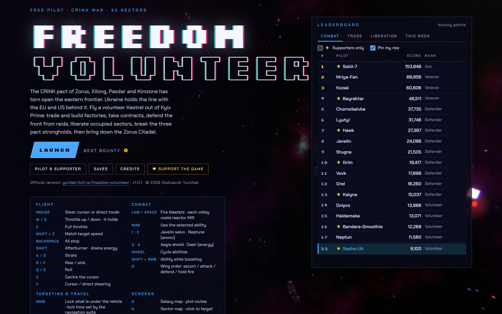
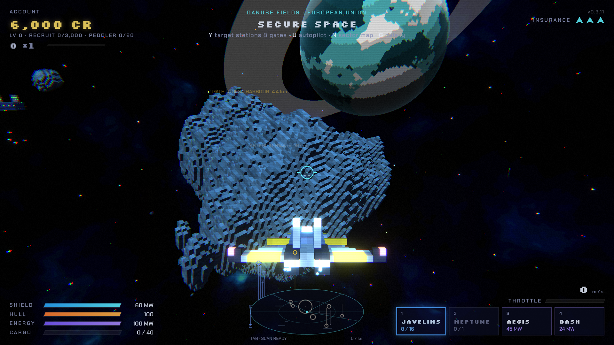
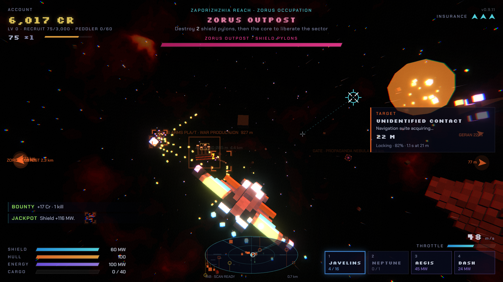

# Freedom Volunteer

 

A volunteer pilot, a battered Potuzhnyi fighter and a frontier at war. Fly out of
Kyiv Prime for the Coalition — Ukraine, with the EU and the US behind it — against
the fictional CRINK pact. Trade and build factories, take contracts, defend the
front from raids, liberate occupied sectors, break the three pact strongholds,
then bring down the Zorus Citadel.

A 3D space sim in voxel-neon style that plays in the browser, no install.

**Devlog page:** https://yur4ak.github.io/freedom-volunteer-devlog/

## What's in it

- **33 hand-placed sectors** joined by jump gates, with a live production economy:
  11 wares, stations that consume and produce, freighters that move goods, prices that follow stock
- **A war front that moves on its own** — raids, occupation, liberation, counter-offensives,
  and pact strength / coalition morale meters
- **Imperfect instruments you upgrade** — the stock navigation suite lags, flickers and loses lock;
  better suites, reactors and software sharpen the picture
- **Enemies with personalities** — kamikaze drones that dodge fire, fighters that make gun runs,
  snipers, minelayers, shielded gunships, drone carriers, EW jammers, flagships, and a rank
  ladder that grows with yours
- **Solid voxel asteroids** you carve one cube at a time, with hidden veins to scan and map
- **Wingmen, hired trader pilots, missions, your own factories**, a pilot log and a campaign save
- **Black holes** lead to two bonus levels: an event-horizon tunnel and a wrapping tesseract
- **Procedural everything** — every ship, station and rock is voxel-generated in code, and all
  sound and music are synthesized live

| | |
|---|---|
|  |  |
| *Undocking at Kyiv Prime* | *The 33-sector galaxy map* |

## Status

**Released · 1.0.4.** Free to play on itch.io, with an optional donation: **a donation of $2 or more
unlocks small cosmetic supporter perks**. Nothing that affects combat or the economy is for sale.

## Where donations go

**30% of every donation, of any amount, goes to the Armed Forces of Ukraine (ZSU).**
The rest supports development of the game.

## Play

**[Play free on itch.io](https://yur4ak.itch.io/freedom-volunteer)** in a desktop browser with mouse and keyboard,
or download the offline version (Windows, macOS, Linux: unzip and open `index.html`).

## Built with

JavaScript · Three.js · WebGL · procedural voxels · synthesized audio · no engine

---

# Updates

## 1 Nov 2026 — 1.0.4: Shahed raids, Moskva cruisers and the Space-Time Drive

- **Potuzhnyi**: the starter ship has a new name. Your saves keep working
- **Bigger hulls hit harder**: Lyutyi now has 3 guns and 120 hull, Ruslan 4 guns, a 10-missile rack and 5 Neptunes, Mriya 8 guns and 10 Neptunes. Heavy hulls fire half their guns in every volley. Each missile rack upgrade adds a Neptune bay
- **Point defence** now fires at every enemy in reach, big ships included, but incoming missiles always come first
- **Space-Time Drive**: jump to any sector in the galaxy at once for 10 Energy Cells, 5 Crystals and 1 Ore. It is rare: the volunteer net announces each shipment hours before it reaches a facility, and it is on sale for only 2 hours
- **Moskva cruisers** guard every pact base, with guns, Kalibr missiles and a jamming field. The Citadel has 5 to 10 of them
- **Shahed raids**: every 10 minutes the pact launches drones at every Ukrainian sector on the front line. Be there and you hear the siren and can shoot them down before they reach the stations
- **Reinforcements**: attack a pact base and every pact fleet sends ships within a few minutes. The higher your rank, the more of them
- **Radio chatter** from nearby patrols, haulers, wingmen and stations, plus some intercepted pact talk

## 30 Oct 2026 — 1.0.3: Volunteer Radio and critical hull damage
- **Volunteer Radio**: free roaming plays five original pieces at random, never the same twice in a row:
  *Kyiv Nights*, *Steppe Wind*, *Sunflower Drift*, *Deep Field* and *Volunteer's March*.
  Played live by the game's own synthesizer. Listen: [Steppe Wind](assets/radio-steppe-wind.mp3)
- **Critical hull**: below 10% hull, systems fail a few seconds at a time: blasters jam, the shield drops,
  engines sputter, sensors black out, the reactor leaks power. A red *Hull critical* chip shows what is down
- **Wrecked upgrades**: keep taking hits at critical hull and an upgraded module can drop back to stock Mk 1;
  the log names it. Break off and dock before it gets that far

## 29 Oct 2026 — 1.0.2: hotfix
- After choosing a HUD theme other than Classic, buttons in the Pilot and Saves tabs stopped responding
  (switches, Remove token, navigation lights, Save callsign, save slots). Fixed

## 29 Oct 2026 — 1.0.1: leaderboard and new supporter perks
- **Leaderboard in the hangar**: Combat, Trade, Liberation and This week (combat points since Monday)
- Opens on **★ supporters only**; untick to see every pilot. **Pin my row** keeps your place in view
- Scores are sent when you dock, jump or liberate a sector; a private pilot key protects your callsign
  and travels with save exports. Opt out under Pilot & supporter, which also deletes your entry
- **New supporter perks**: Ukraine livery (azure and gold), Blue & Gold HUD theme, and navigation lights
  with three presets: Airliner, Night patrol and Airshow

## 29 Oct 2026 — 1.0.0: out on itch.io
- **Free to play** in the browser, plus an offline version (unzip and open `index.html`)
- **Supporter perks are live**: donate $2 or more, then paste the address of your itch.io purchase page
  under Pilot & supporter → Redeem. The server checks the purchase and returns a signed token tied to your callsign
- One file, no outside requests; only redeeming and the leaderboard go online
- **30% of every donation goes to the ZSU**; a running total will be posted here

## 16 Oct 2026 — 0.9.12: pilots, saves and supporters
- **Hangar menu** on the title screen: Pilot & supporter, Saves, Credits and ♥ Support the game
- **Callsign**: pick your pilot name (Latin or Cyrillic); it shows in the HUD and in comms
- **Saves you can carry**: export your campaign as a `.fvsave` file or a short code and import it anywhere,
  plus 3 automatic backups
- **Supporter perks**, all cosmetic: Sunflower, Night Watch and Kozak liveries, Founding Volunteer gold trim,
  a ★ badge, extra save slots and HUD themes (Amber CRT, Vyshyvanka red, Night-vision green).
  A colorblind-safe HUD theme is free for everyone
- **Credits** with the open-source licenses and a privacy note: no ads, no tracking
- The release build is ready: everything in one file, no outside requests
- Donations: **$2 or more unlocks the perks, and 30% of every donation goes to the ZSU**

## 15 Oct 2026 — 0.9.11 and the road to 1.0
- New version scheme: pre-release builds are **0.9.N**; the public release will be **1.0.0**.
  Earlier builds v1–v10 are renumbered 0.9.1–0.9.10 below
- The version now shows as a small label in the corner of the HUD
- The itch.io page is set up and waiting in Draft, with covers, logos, screenshots and a combat GIF
  captured straight from the game
- Plan for 1.0: credits, callsigns, save export and import, and the supporter perks.
  Leaderboards, cloud saves and the Volunteer Wall follow as updates after launch

## 14 Oct 2026 — 0.9.10: the name is official
- **Freedom Volunteer** is now the name everywhere: title screen, interface and the Codex
- Supply runs can be split across several trips; the mission board shows a delivery progress bar
  and the HUD counts down what is still due. Miss the deadline and you are still paid half rate
  for what you delivered
- No more duplicate supply runs for the same goods at the same station
- The sector map shows its zoom level and the radius in view
- Donation terms settled: **a donation of $2 or more unlocks the supporter perks**, and **30% of every donation goes to the ZSU**

## 14 Oct 2026 — Getting ready to publish
- Mapped the full path to a public release in nine steps: decisions, accounts, names and legal,
  release build, supporter system, the itch.io page, testing, launch, and after-launch care
- Set up this devlog and a private source repository

## 13 Oct 2026 — Rights, credits and security
- The game stays **all rights reserved**; the source repository is private
- Planned a credits screen with the open-source licenses the game relies on
- Supporter codes will be checked by a small server and returned as signed tokens,
  so no secret ever ships inside the game

## 11 Oct 2026 — The publishing plan
- Chose itch.io: it handles payments, tax and refunds, and web games are first-class there
- Perks will be cosmetic only — liveries, a supporter badge, a Volunteer Wall, extra save slots, HUD themes

## 0.9.9 — Jammers, warrior ranks and a sound fix
- **Zhitel EW jammers**: big, slow, shielded ships whose 500 m fields scramble your sensors.
  Three overlapping fields blind you. They guard every pact command post
- **Enemy warrior ranks**, from Ryadovoy to General. They scale with your own pilot level,
  so veterans face tougher pilots — and better loot
- Factions now pay high-ranked pilots to patrol their space; salvaging abandoned cargo earns rank
- Rank ladders show the points to your next rank; trader pilots show their lifetime earnings
- Louder, rebalanced audio with a status chip when the browser blocks sound
- Weapon boosts last 1–3 minutes

## 0.9.8 — Rocks, harvesters and the full Codex
- Giant asteroids come in new shapes, including rare ones with a tunnel bored right through
- Internal scans now take time, then map the veins from the surface inward
- Salvage harvesters sweep the whole sector for drifting cargo
- A persistent, scrollable flight log
- The Codex now documents every rule in the game: drop chances, damage, prices, raids, missions

## 0.9.7 — Solid asteroids and docking
- Big rocks are truly solid: each hit removes exactly one voxel; cut pieces loose and they crumble
- Giants up to 200 m across drift slowly around each sector; hidden ore, silicon, crystal and ice veins
- Docking computers with real approach ranges; sensor range jitter and a laggy radar on stock kit

## 0.9.6 — Glitchy sensors and a tighter economy
- Lock time and target data depend on distance; weak sensors glitch and garble
- Global scans reveal hidden pact spies and deep-space signals
- Armoured missiles, outpost grades I–V, flak point defence
- Money is harder to come by; a combat-focus HUD fades friendly markers when enemies close in

## 0.9.5 — Sensors, power and smarter enemies
- Five navigation-suite levels, target lock, global scan, electronic warfare
- Power measured in MW, reactors that limit what a hull can run, point-defence turrets
- Enemies roll their own personalities and take turns attacking
- Derelicts, beacons, booby-trapped crates, harvesters, couriers, wing orders and hired traders

## 0.9.4 — Collisions, music and the first Codex
- Collision boxes, middle-click targeting, three music modes
- Economy events and front politics
- **The Codex**: a searchable archive of every ship, station, ware and sector, generated from the game's own data

## 0.9.3 — The frontier
- The shooter became a living space sim: the Coalition against the CRINK pact
- 33 sectors, jump gates, a production economy, missions, reputation and a dynamic war front
- Docking screens, galaxy and sector maps, a pilot log and campaign saves

## 0.9.2 — Campaign
- Credits, a galaxy chart and station shops between sectors
- The first enemy got its name and its brains: Geran kamikaze drones that dodge fire and, when crippled, back off to snipe

## 0.9.1 — 7 Oct 2026 — The shooter
- A voxel-neon 3D shooter: mouse flight, shields and hull, three ships, abilities
- Eight enemy types, a Dreadnought boss every fifth wave, infinite procedural space
- Wormholes to harder sectors and black holes to bonus levels

---

*Early builds used the working title Voxel Frontier.*
Created, designed and directed by **Oleksandr Yurchak**, programmed with AI assistance (Claude, Anthropic).
© 2026 Oleksandr Yurchak. All rights reserved — see [LICENSE](LICENSE).
